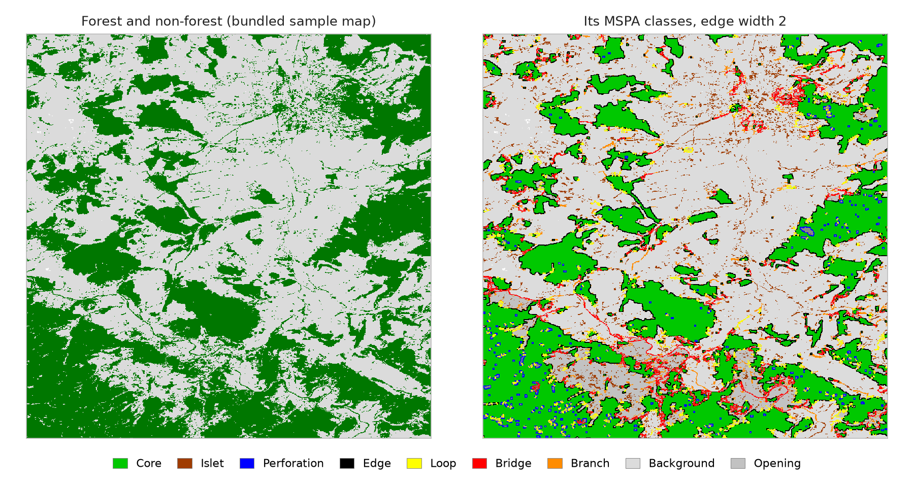

<p align="center">
  <picture>
    <source media="(prefers-color-scheme: dark)" srcset="https://raw.githubusercontent.com/sacridini/terraflux/main/assets/logo/terraflux-logo-dark.svg">
    
  </picture>
</p>

<p align="center">
  <b>Fast, validated landscape ecology for Python.</b><br>
  Habitat patterns, landscape metrics, connectivity, conservation planning,<br>
  species distributions, animal movement and land change, from a single raster to maps larger than memory.
</p>

<p align="center">
  <a href="https://pypi.org/project/terraflux-py/"></a>
  <a href="https://pypi.org/project/terraflux-py/"></a>
  <a href="https://github.com/sacridini/terraflux-py/actions/workflows/release.yml"></a>
  <a href="https://doi.org/10.5281/zenodo.24515396"></a>
  <a href="https://github.com/sacridini/terraflux-py/blob/main/LICENSE"></a>
</p>

<p align="center">
  <a href="https://sacridini.github.io/terraflux/python/">Documentation</a> ·
  <a href="https://sacridini.github.io/terraflux/python/getting-started/">Getting started</a> ·
  <a href="https://sacridini.github.io/terraflux/python/api/">API reference</a> ·
  <a href="https://sacridini.github.io/terraflux/">Desktop application</a>
</p>

---

**terraflux** brings the established methods of landscape ecology together in a single
Python package: a C++17/OpenMP core behind a NumPy, xarray, dask and rasterio API.
Each method reproduces its reference implementation, verified against that tool's own
outputs in the test suite, and typically runs from a few to several hundred times faster.

The library also powers [Terraflux](https://sacridini.github.io/terraflux/), a desktop
application in which the same methods are nodes of a visual model. Both share the same
C++ core, and any Terraflux model can be exported as a Python script that uses this
library (**File > Python script...**), ready for a paper's supplement, a reviewer or an
HPC cluster.

<p align="center">
  
</p>

## Features

| Area | What it covers | Reproduces |
|---|---|---|
| **Habitat patterns** | MSPA, SPA, object accounting, contortion | GuidosToolbox |
| **Fragmentation** | density at many scales (FAD, FOS), landscape mosaics, contagion, entropy | GuidosToolbox |
| **Landscape metrics** | 133 patch, class and landscape metrics, sample plots, moving windows, time series | landscapemetrics, FRAGSTATS |
| **Habitat networks** | PC, IIC, ECA, node and link importance, ProtConn | Conefor, Makurhini |
| **Circuit connectivity** | omnidirectional and pairwise current flow, rasters and networks | Circuitscape, Omniscape |
| **Distance & restoration** | cost surfaces, least-cost paths and corridors, isochrone maps | GuidosToolbox |
| **Change detection** | simple and morphological change, fragmentation transitions | GuidosToolbox |
| **Routes on grids** | transitions from any rule, travel-time surfaces, least-cost distances and paths, random walks, randomised shortest paths, route overlap, energy landscapes | gdistance, enerscape |
| **Surface metrics** | texture of continuous rasters (ISO 25178): roughness, height distribution, bearing area curve, slopes, peaks and valleys, autocorrelation, orientation, fractal dimension, trend surfaces, texture images; terrain indices (TPI, TRI, VRM, curvature, HLI...) | geodiv, spatialEco |
| **Terrain hydrology** | depression filling, D8, D-infinity and multiple flow directions, flow accumulation, streams, height above the nearest drainage (HAND), wetness, stream power and sediment transport indices | WhiteboxTools |
| **Neutral landscape models** | simulated landscapes as null models: random, percolation, gradients, fractal surfaces, Gaussian fields, mosaics, clusters, classification | NLMR |
| **Biodiversity analysis** | species records in grid cells: richness, endemism, phylogenetic diversity and endemism, randomisations, CANAPE, clustering | Biodiverse |
| **Spatial prioritization** | ranking of whole landscapes for many features (CAZ and ABF rules), weights, costs, hierarchical masks, connectivity transforms, performance curves, post-processing, impact assessment; maps larger than memory | Zonation 5 |
| **Species distributions** | cleaning and thinning occurrence records, accessible area, collinearity filters, background points, spatial cross-validation folds, evaluation (AUC, TSS, Boyce index), Maxent (MaxNet), ensembles of scikit-learn models, projection and extrapolation (MESS, MOP, ExDet) | CoordinateCleaner, spThin, usdm, dismo, blockCV, ENMeval, ecospat, predicts, maxnet, mop |
| **Animal movement** | Movebank tracks, steps on the sphere and the ellipsoid, cleaning and thinning, interpolation, home ranges (MCP, KDE, LoCoH), dynamic Brownian bridges (dBBMM, dBGB), utilisation distributions and their distances, step selection (SSF, iSSF) and its simulation, covariates along steps, corridors, validation of connectivity maps | move2, amt, move2utils |
| **Land change simulation** | change analysis (intensity, components of difference, Markov chains), transition potential (weights of evidence, logistic regression, any scikit-learn model), allocation (CLUE-S, ordered, land systems, Expander/Patcher, random patch seeds, patch growing), dynamic variables, regional demands, validation at several resolutions, fuzzy similarity, calibration, scenarios with replicates | lulcc, OpenLand, diffeR, CLUMondo, FUTURES, MOLUSCE, Dinamica EGO, PLUS |
| **Ecosystem services** | carbon storage and sequestration with valuation, habitat degradation, quality and rarity, crop pollination by wild bees | InVEST |
| **Vector analysis** | `tf.vector`: spatial predicates and selection by location, spatial joins, nearest features (k nearest), overlay, buffers, dissolve, hulls, split and shape operations, named as in PostGIS | PostGIS (semantics) |
| **Large data** | out-of-core processing by tiles and row blocks, parallel batches of rasters, work distributed across a lab's computers (`terraflux-py worker`) | |

## Installation

```bash
pip install terraflux-py
```

The distribution is named `terraflux-py` on PyPI and is imported as `terraflux`
(`import terraflux as tf`). Binary wheels are available for CPython 3.10–3.14 on Windows
(x86-64), macOS 11+ (Apple silicon and Intel) and Linux (x86-64, ARM64). They bundle the
OpenMP runtime, so no compiler is required and every tool works out of the box.
In a conda environment, install the geospatial stack from conda-forge first, then
terraflux with pip:

```bash
conda create -n terraflux -c conda-forge python=3.12 rasterio rioxarray geopandas
conda activate terraflux
pip install terraflux-py
```

Building from source (other platforms, development) requires a C++17 compiler; see the
[installation guide](https://sacridini.github.io/terraflux/python/getting-started/installation/).

### Containers

Each release is published as a container image (x86-64 and ARM64) on the GitHub
Container Registry, with every optional feature included and nothing to install on the host:

```bash
docker run --rm -it -v "$PWD:/data" ghcr.io/sacridini/terraflux-py                 # Python shell
docker run --rm -v "$PWD:/data" ghcr.io/sacridini/terraflux-py python analysis.py  # run a script
```

The current directory is mounted at `/data`, the container's working directory. For
reproducible work, pin a release (`ghcr.io/sacridini/terraflux-py:<version>`, e.g. `:1.62.0`).
On Linux, add `--user "$(id -u):$(id -g)"` so that the files written to `/data` belong to
you, and a named volume keeps downloaded data between runs:

```bash
docker run --rm --user "$(id -u):$(id -g)" -v "$PWD:/data" \
  -v terraflux-cache:/home/terraflux/.cache ghcr.io/sacridini/terraflux-py python analysis.py
```

The image is a standard OCI image, so other runtimes use it as is:

| Runtime | Command |
|---|---|
| Podman (rootless) | `podman run --rm --userns=keep-id -v "$PWD:/data" ghcr.io/sacridini/terraflux-py python analysis.py` |
| Apptainer / Singularity (HPC) | `apptainer pull terraflux.sif docker://ghcr.io/sacridini/terraflux-py:<version>`<br>`apptainer exec terraflux.sif python analysis.py` |
| Enroot + Pyxis (Slurm) | `srun --container-image=ghcr.io#sacridini/terraflux-py:<version> --container-mounts="$PWD:/data" python analysis.py` |

On a cluster, `terraflux-py slurm` run inside the Apptainer image writes job scripts whose
tasks run in the same image; see
[HPC and Slurm](https://sacridini.github.io/terraflux/parallel/hpc-slurm-in-python/).
To build the image yourself, see the comments at the top of the `Dockerfile`.

## Quick start

```python
import terraflux as tf

forest = tf.load_raster(tf.example_data("input"))    # bundled sample map
morph = tf.mspa(forest, edge_width=2)                # cores, edges, bridges, loops...
tf.write_raster(morph, "forest_mspa.tif")            # GeoTIFF with its colour table
print(tf.mspa_stats(morph))
```

```text
                pixels   pct_data  pct_foreground
class
Core            264641  26.471247       61.761301
Islet            26040   2.604703        6.077155
Perforation       9608   0.961059        2.242293
Edge             59657   5.967311       13.922612
Loop             20237   2.024247        4.722864
Bridge           27772   2.777950        6.481365
Branch           20535   2.054055        4.792411
Background      514124  51.426285             NaN
Core-Opening      2732   0.273274             NaN
Border-Opening   54384   5.439869             NaN
Missing            270        NaN             NaN
```

```python
landcover = tf.load_raster(tf.example_data("clc"))
print(tf.landscape_metrics(landcover, level="landscape", metric=["shdi", "contag", "ed"]))
```

```text
       level  class    id  metric      value
0  landscape   <NA>  <NA>  contag  69.457769
1  landscape   <NA>  <NA>      ed  23.224800
2  landscape   <NA>  <NA>    shdi   1.809602
```

Every function accepts NumPy arrays, georeferenced `xarray.DataArray`s or dask arrays,
and returns the same type. Parallel functions use three quarters of the available cores
(15 of 20, 6 of 8), never all of them, as the desktop application does; pass `n_threads`
or set `TERRAFLUX_THREADS` to use fewer.

### Coming from landschaft

The library was called **landschaft** up to version 1.58, and existing code keeps working:
`pip install landschaft` installs terraflux, `import landschaft as ls` exposes the same
modules (with a `DeprecationWarning`), the `LANDSCHAFT_*` environment variables are still
honoured, and files written by landschaft (GeoTIFF tags, bio sessions, batch records,
pickles) load in terraflux. To migrate, replace `import landschaft as ls` with
`import terraflux as tf` and `ls.` with `tf.`; the `landschaft` command is now `terraflux-py`.

## Documentation

The documentation lives on the Terraflux website, **<https://sacridini.github.io/terraflux/python/>**:
a getting-started guide, tutorials by topic (every Terraflux tutorial includes its Python
version), the complete API reference with runnable examples, the algorithms behind the
tools, and the [benchmarks](https://sacridini.github.io/terraflux/benchmarks/) of accuracy and speed.
The site is built from the Terraflux repository
([sacridini/terraflux](https://github.com/sacridini/terraflux), `website/`), and its API
pages are generated from this library's docstrings.

## Validation and performance

Every tool is compared in the test suite with the program it reproduces: pixel for
pixel where the output is a map, value for value (to the last bit wherever the original
arithmetic can be reproduced) for tables, and to the original's own precision for
floating-point solvers. Typical speed-ups on the benchmark cases:

| Tools | Compared with | Agreement | Speed-up |
|---|---|---|---|
| MSPA | GuidosToolbox `mspa` 2.3 | identical pixels | 10–17× |
| Landscape metrics | landscapemetrics 2.2.2 | identical bits | 35–500× |
| Habitat networks | Makurhini, Conefor | to 1e-12 | 13–620× |
| Omniscape, Circuitscape | Omniscape 0.7, Circuitscape 6.1 | to 2e-11 | 3–45× |
| Grid distances | gdistance 1.6 | identical bits (least cost); 1e-14 (random walks) | 3–400× |
| Neutral landscape models | NLMR 1.4 (same seed) | identical bits | 2–6000× |
| Spatial prioritization | Zonation 5 v2.4 | identical rank maps and output files | 4–11× |
| Species distributions | CoordinateCleaner, spThin, usdm, dismo, blockCV, ENMeval, predicts, maxnet | identical bits, random steps included (same seed) | maxnet 14×, kmeans 8×, weighted sampling 70× |
| Animal movement | move2 0.5, amt 0.3.1, move2utils 0.4.6 | identical bits, R's random numbers included (to 1e-14 off Windows) | dBBMM 6–8×, dBGB 3–5× (8 threads) |
| Land change simulation | lulcc, OpenLand, diffeR, CLUMondo, r.futures, MOLUSCE; Dinamica EGO (measured) | identical bits (R's and NumPy's random numbers included); Dinamica to its 15 digits | 7–43× |

Methods, machines, full tables and known differences are documented in the
[benchmarks](https://sacridini.github.io/terraflux/benchmarks/). To run the test suite:

```bash
pip install -e ".[test]"
pytest
```

## How to cite

If terraflux contributes to published work, please cite the software and the papers of
the methods you used. The concept DOI always resolves to the latest release; each
release also has its own DOI on [Zenodo](https://doi.org/10.5281/zenodo.24515396):

> Lacerda, E. terraflux-py: Terraflux's Python library for landscape analysis. Zenodo.
> https://doi.org/10.5281/zenodo.24515396

```bibtex
@software{lacerda_terraflux_py,
  author    = {Lacerda, Eduardo},
  title     = {terraflux-py: Terraflux's Python library for landscape analysis},
  publisher = {Zenodo},
  doi       = {10.5281/zenodo.24515396},
  url       = {https://doi.org/10.5281/zenodo.24515396}
}
```

The same metadata is in [`CITATION.cff`](https://github.com/sacridini/terraflux-py/blob/main/CITATION.cff)
(GitHub's *Cite this repository* button). The references of each method are listed on the
[citing page](https://sacridini.github.io/terraflux/about/citing/) and in the API reference.
For MSPA, for example:

* Soille, P. & Vogt, P. (2009). Morphological segmentation of binary patterns.
  *Pattern Recognition Letters* 30(4), 456–459. doi:10.1016/j.patrec.2008.10.015
* Vogt, P. & Riitters, K. (2017). GuidosToolbox: universal digital image object
  analysis. *European Journal of Remote Sensing* 50(1), 352–361.
  doi:10.1080/22797254.2017.1330650

## Support and contributing

Bug reports, questions and feature requests are welcome on the
[issue tracker](https://github.com/sacridini/terraflux-py/issues). When reporting a
difference from a reference tool, please include the tool's version, the call and, if
possible, a small input that reproduces it. `terraflux-py doctor` prints the versions
and settings worth attaching to a report.

## Versioning

terraflux follows [Semantic Versioning](https://semver.org/): from 1.0 onwards, the public
API changes incompatibly only in a new major version. Version numbers continue those of
landschaft (the first release as terraflux was 1.59.0). All changes are listed in the
[changelog](https://github.com/sacridini/terraflux-py/blob/main/CHANGELOG.md).

## License and credits

terraflux is free software under the GPL-3.0-or-later. It ports code from GuidosToolbox
and miallib, © European Union (Joint Research Centre), by Pierre Soille, Peter Vogt et al.,
both GPL-3.0-or-later; the example maps in `src/terraflux/data` come from the
[GTB repository](https://github.com/ec-jrc/GTB). GTB's `mspa` states that its interface is
made available for non-commercial purposes: contact the JRC for commercial use of MSPA.
